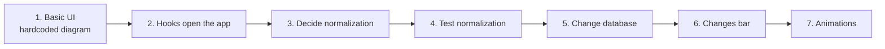

# Visor build plan

This plan builds Visor in seven steps. Each step ends in an outcome you can test before you start the next one. The plan follows the decisions D1–D7 in [FEASIBILITY_REPORT.md](FEASIBILITY_REPORT.md).

## Assumptions

- **Desktop shell: Electron.** The report recommends it (open question 3). Electron runs the Node server in its main process, so one app holds the server, the database, and the UI. If you pick Tauri instead, steps 1, 2, and 5 change.
- **Language: TypeScript everywhere.** The app, the hook forwarder, the parser, and the later VS Code extension share one set of types.
- **Platform: Windows first.** Hook commands and data paths in this plan are Windows paths. Paths inside the protocol use forward slashes, so macOS and Linux can follow later.
- **Sandbox project.** Keep a small Python project outside this repo, for example `D:\Projects\visor-sandbox`, for the Copilot agent to edit during manual tests.

## Rules for every step

- Each step ends with automated tests and one manual demo. Start the next step only when both pass.
- Keep `pnpm test` green on every commit.
- Change the protocol from step 3 only by adding fields or by bumping its version.
- Put each new capability behind the seam that its step names. Later languages, agents, and storage then plug in without rewrites.

## Repository layout

Create this layout in step 1 and fill it in as you go.

```text
(repo root)
  apps/
    desktop/            Electron app. Main process: HTTP server, ingest, store. Renderer: React UI.
    hook/               visor-hook CLI that the agent hooks call
    vscode-extension/   companion extension (after step 7)
  packages/
    protocol/           types and zod schemas for the normalized data (step 3)
    core/               pure functions: event normalizer, Python extractor, model differ (step 4)
    store/              SQLite storage behind the ChangeStore interface (step 5)
  fixtures/
    raw-hooks/          real hook payloads captured in step 2
    normalized/         expected normalizer output (step 4)
    python/             Python source pairs, before and after (step 4)
    sessions/           seeded sessions for UI tests (step 6)
```

| Need | Tool |
|---|---|
| Workspace and scripts | pnpm workspaces, TypeScript in strict mode |
| Desktop build | Electron with electron-vite |
| UI | React, React Flow, Framer Motion |
| Layout | ELK.js (step 7) |
| Parsing | web-tree-sitter with tree-sitter-python (step 4) |
| Schemas | zod |
| Storage | better-sqlite3 (step 5) |
| Unit tests | Vitest |
| UI tests | Playwright, using its Electron support |

## Step overview



Step 2 captures real hook payloads. Step 3 then designs the normalized format from those payloads instead of from guesses.

---

## Step 1: Build the basic UI with a hardcoded class diagram

**Goal:** a Visor window that matches the sketch and draws a hardcoded class diagram. You fill in the visual details. This step fixes only the structure and the seams.

```text
+------------+----------------------------------------------+
|  VISOR     |  Session Name                                |
+------------+                                              |
|  Changes   |   +-----+        +-----+        +-----+      |
|            |   |  A  | -----> |  B  | -----> |  C  |      |
| [Change 4] |   |     |        |     |        |     |      |
|  Change 3  |   +-----+        +-----+        +-----+      |
|  Change 2  |                                              |
|  Change 1  |                                              |
|            |                                              |
+------------+                                              |
|  Settings  |                                              |
+------------+----------------------------------------------+
```

### Build

1. **Scaffold the repo.** Create the pnpm workspace, the TypeScript config, Vitest, and `apps/desktop` with electron-vite. In the renderer, turn on `contextIsolation` and `sandbox`, and turn off `nodeIntegration`.
2. **Build the shell.** Add the sidebar with the title, the **Changes** list, and the **Settings** button. Add the main panel with the session name header and the diagram canvas.
3. **Draw the diagram.** Render class nodes with React Flow. Each node shows the class name and its methods. Draw the edges as arrows.
4. **Add method hover.** When you hover over a method, a tooltip shows its signature and docstring.
5. **Load the hardcoded data from a fixture.** Put the classes, methods, edges, and changes in `apps/desktop/src/renderer/fixtures/sample-diagram.json`. Load the file through a `DiagramSource` interface. Components never import it directly.

### Seams for later steps

- `DiagramSource` returns a `DiagramView`. Step 3 adds an adapter from the protocol model, and step 6 replaces the fixture with live data.
- Node and edge components take only `DiagramView` props. They don't know where the data comes from.
- Node positions come from a `layout(view)` function. In step 1 it returns fixed positions. Step 7 replaces it with ELK.

### Test

- **Automated:** a Playwright test launches the app. It checks for 3 class nodes, 2 edges, and 4 change entries, and for the right signature in the tooltip when you hover over a method.
- **Manual:** run `pnpm --filter desktop dev` and compare the window with the sketch.

**Done when** the window matches the sketch and the UI test passes.

---

## Step 2: Create hooks that open the Visor app

**Goal:** when a Copilot agent session starts in VS Code, the Visor window opens or comes to the front. The app does no analysis yet.

### Build

1. **Start a local server in the app.** On launch, the Electron main process does the following:
   - It takes the single-instance lock with `app.requestSingleInstanceLock()`. A second launch then focuses the existing window.
   - It starts an HTTP server on `127.0.0.1` on a free port.
   - It creates a random token and writes `{ port, token, pid }` to `%APPDATA%\Visor\runtime.json`.
   - It serves `GET /health` and `POST /hooks/raw`. Both require `Authorization: Bearer <token>`, and both reject requests that carry a browser `Origin` header.
2. **Write the `visor-hook` CLI** in `apps/hook`.
   - It reads the event name from its first argument and the hook payload from stdin.
   - It wraps the payload as `{ id, source: "copilot", event, receivedAt, payload }`, with a new unique `id`.
   - It reads `runtime.json`. If the app isn't running, it launches the app from `VISOR_APP_PATH` or from the path in `%APPDATA%\Visor\config.json`. Then it waits up to 3 seconds for `runtime.json` to appear.
   - It posts to `/hooks/raw` with a 500 ms timeout.
   - It always exits with code 0, so it never blocks or breaks the agent.
3. **Register the hooks in VS Code.** In the sandbox project, add a Copilot agent hook file for `SessionStart`, `UserPromptSubmit`, `PreToolUse`, `PostToolUse`, and `Stop`. Each hook runs `visor-hook <event>`. Agent hooks are in preview, so confirm the file location and format in the VS Code documentation before you write the file.
4. **Show that events arrive.** Put the session ID in the **Session Name** header. In **Settings**, add a dev toggle that shows a debug list of the raw payloads.
5. **Capture fixtures.** In dev mode, the app saves each raw payload to `fixtures/raw-hooks/<event>-<n>.json`. Remove user paths and secrets from the files, then commit at least one payload for each event.

### Seams for later steps

- The `source` field marks which agent sent an event. Claude Code and Cursor later add their own sources, with no new endpoints.
- `runtime.json` is the only way to find the app. The companion VS Code extension uses it later.

### Test

- **Automated:**
  - `visor-hook` unit tests run against a mock server. The CLI posts the wrapped payload. It exits with code 0 when the server is down. It also exits with code 0 when stdin isn't valid JSON.
  - Server tests check that `/health` returns 401 without the token and 200 with it, and that a request with an `Origin` header is rejected.
- **Manual:** close Visor. Start a Copilot agent session in the sandbox project and ask it to edit a Python file. Visor opens, the header shows the session ID, and the debug list shows the session start, prompt, and tool events in order. Start a second session. The same window comes to the front.

**Done when** a real Copilot session opens Visor and `fixtures/raw-hooks/` holds a real payload for each event.

---

## Step 3: Decide how to normalize the data

**Goal:** one written, versioned contract for everything Visor stores and draws, based on the payloads captured in step 2.

### Decide

Record each decision in the README of `packages/protocol`. The table gives the recommended answer.

| Decision | Recommendation |
|---|---|
| What one entry in the changes bar means | One agent tool call that edits files, which is one `PostToolUse` event. Edits from other sources within 2 seconds merge into the same change. |
| Symbol IDs | `<language>:<workspace-relative path>::<Class>[.<member>]`, for example `py:src/shop/cart.py::Cart.add_item`. The language prefix leaves room for C++ and C#. |
| Paths | Relative to the workspace, with forward slashes |
| Time | Epoch milliseconds, set by the Visor app when the event arrives. The agent's own timestamp stays as an extra field. |
| Order | A per-session `seq` number that the app assigns |
| Event IDs | The `id` that `visor-hook` creates in step 2, so a resent event is stored once |
| Versioning | Every document carries `v: 1`. Added fields keep the version. Breaking changes bump it. |

### Build

1. **Map the raw fields.** For each captured payload, list the fields Visor needs and where each one sits in the payload. Visor needs at least the session ID, the tool name, the file paths, and the prompt text.
2. **Define the types and zod schemas** in `packages/protocol`:
   - `VisorEvent` is the envelope `{ v, id, sessionId, seq, ts, source, kind, payload }`. Its kinds are `session.started`, `session.ended`, `prompt.submitted`, `edit.pending`, `edit.applied`, `file.created`, `file.deleted`, and `file.renamed`.
   - `CodeModel` holds the classes in the workspace. `ClassSymbol` is `{ id, name, file, range, bases, methods, fields }`. `MethodSymbol` is `{ id, name, signature, docstring, range, bodyHash }`. `Relation` is `{ from, to, kind }`, where `kind` is `"inherits"`, `"composes"`, `"calls"`, or `"imports"`.
   - `Change` is one entry in the changes bar: `{ id, sessionId, seq, ts, cause, summary, files, delta }`.
   - `GraphDelta` holds the operations from the feasibility report, such as `node.add` with an optional `insertedBetween`, `node.remove`, `member.change`, `edge.add`, and `edge.remove`.
3. **Write example documents.** Add valid and invalid examples of each type to `packages/protocol/examples/`.
4. **Connect the UI to the protocol.** Rewrite the step 1 fixture as a `CodeModel` and a list of `Change` documents. Add `toDiagramView(model, change)` and point `DiagramSource` at it.

### Seams for later steps

- `HarnessAdapter { source, toEvents(raw): VisorEvent[] }` converts one agent's payloads. Copilot is the first adapter.
- `LanguageExtractor { language, matches(path), extract(path, text): FileModel }` reads one language. Python comes first, then C++, then C#.
- `Relation.kind` and the `GraphDelta` operations are string unions. Data-flow edges (D5) add new kinds later without changing the existing ones.

### Test

- **Automated:**
  - Every valid example passes its schema. Every invalid example fails with the expected error.
  - The schemas export to JSON Schema without errors.
  - The step 1 UI test still passes against the rewritten fixture.
- **Manual:** read each captured payload next to the mapping from build item 1. Confirm that every field Visor needs has a source.

**Done when** `packages/protocol` is at `v: 1`, every decision in the table is recorded, and the UI renders from the protocol format.

---

## Step 4: Test basic normalization

**Goal:** working code that turns raw hook payloads and Python source into protocol documents, proven by golden tests.

### Build and test each part

1. **Event normalizer.** The Copilot `HarnessAdapter` turns each raw payload into `VisorEvent` documents.
   - Test: each file in `fixtures/raw-hooks/` produces the matching file in `fixtures/normalized/`. A malformed payload returns an error and never throws.
2. **Python extractor.** `PythonExtractor` uses web-tree-sitter and tree-sitter-python to turn a source file into a `FileModel`. The model holds the classes, the methods with signatures and docstrings, the fields, the base classes, and the imports.
   - Test with files in `fixtures/python/`: a simple class, inheritance, nested classes, decorators and properties, module-level functions, and a file with a syntax error inside a method. For the broken file, the extractor still returns every class it can read.
3. **Model differ.** `diffModels(before, after)` returns `GraphDelta[]`.
   - Test one before-and-after pair per case: a class added, a class removed, a method added, a base class changed, and a method body changed. The changed body gives `member.change`, which the UI later shows as a pulsing glow (D6). Also test `A → B` becoming `A → C → B`, which the differ tags as `insertedBetween: [A, B]`.
4. **Replay command.** `pnpm visor replay <fixture-session>` runs captured events and source files through parts 1 to 3 and prints the resulting `Change` list.
   - Test: the replay output matches a committed golden file.
5. **Wire the normalizer into the app.** `POST /hooks/raw` now validates and normalizes each payload, and the debug list shows normalized events. The app logs and drops a payload that fails, and keeps running.

### Seams for later steps

- Everything in `packages/core` is a pure function with no file or network access. The app reads files and passes the text in.
- An extractor registry picks a `LanguageExtractor` by file path. C++ and C# register their own extractors later.

### Test

- **Automated:** `pnpm --filter core test` runs every golden test.
- **Manual:** run a Copilot session in the sandbox project. The debug list shows normalized events, and each one passes its schema.

**Done when** every golden test passes and a live session produces only valid normalized events.

---

## Step 5: Create the database for changes

**Goal:** Visor saves every session and every change, and both survive an app restart.

### Database tables

The database lives at `%APPDATA%\Visor\visor.db`, outside the user's project (D7).

| Table | Holds |
|---|---|
| `projects` | `id`, `root_path`, `name` |
| `sessions` | `id`, `project_id`, `source`, `title`, `started_at`, `ended_at` |
| `events` | Every normalized `VisorEvent`, append-only. `id` is unique, so the store ignores a resent event. |
| `changes` | `id`, `session_id`, `seq`, `ts`, `summary`, `delta_json`, `model_after_json` |
| `change_files` | `change_id`, `path`, `before_hash`, `after_hash` |
| `blobs` | File contents keyed by content hash. Each version is stored once. |
| `schema_migrations` | The numbers of the migrations already applied |

### Build

1. **Create the store** in `packages/store` with better-sqlite3 and numbered SQL migration files.
2. **Hide SQLite behind interfaces.** The app uses `ChangeStore` and `SnapshotStore` and never runs SQL directly.
3. **Record a baseline at session start.** On `session.started`, scan the project's Python files, extract the `CodeModel`, and save it as change 0 of the session.
4. **Build the change pipeline.** On `edit.applied`, read the file, extract it, and diff it against the current model. Save the `Change`, its files, and its blobs in one transaction. Then notify the renderer.
5. **Close sessions.** On `session.ended`, set `ended_at`.

better-sqlite3 is a native module, so Electron needs it rebuilt for Electron's Node version. Add the rebuild to the install script in the first commit of this step.

### Seams for later steps

- `SnapshotStore` has a SQLite version now. The dedicated history git repository (D7) becomes a second version later, and the pipeline doesn't change.
- Each change stores `model_after_json`. The UI can then show any change without replaying the changes before it.

### Test

- **Automated:**
  - Store tests run on an in-memory database. Migrations apply in order. A duplicate event is stored once. A failed change insert rolls back completely.
  - A pipeline test posts a fixture session to the running app and checks the expected rows in `sessions`, `changes`, and `change_files`.
- **Manual:** run a Copilot session that adds a class and edits another class. Close and reopen Visor. Run `pnpm visor dump --session <id>`. It prints the baseline and both changes.

**Done when** a real session's changes are in the database and still there after a restart.

---

## Step 6: Display the changes bar

**Goal:** the sidebar lists the session's changes, newest first. Selecting an entry shows the diagram as it was after that change.

### Build

1. **Give the renderer read access** through the preload script with `contextBridge`: `listSessions()`, `listChanges(sessionId)`, `getChange(id)`, and `onChangeAdded(callback)`. The renderer gets no Node or database access.
2. **Fill the changes list.** Show the newest change at the top, as in the sketch. Each entry shows a summary, the time, and the number of files. Example summaries: "Added class `Invoice`" and "Changed `Cart.add_item`".
3. **Show the selected change.** Selecting an entry draws that change's `model_after`. Classes that the change added get a highlight. Classes that it changed get a pulsing glow (D6).
4. **Follow the agent.** A **Live** toggle keeps the newest change selected as changes arrive. Selecting an older change turns **Live** off.
5. **Add keyboard support.** The Up Arrow and Down Arrow keys move through the list.
6. **Fill the header.** The session name is the first prompt, cut to one line. If the session has no prompt, the name is the start time.
7. **Add a basic Settings panel.** It shows the data folder, the server port, and the dev toggle.

### Seams for later steps

- The list renders from `Change` documents only. A new change kind needs a summary formatter and an icon, and no change to the list itself.
- The list already takes a `sessionId`, so a session picker can sit above it later.

### Test

- **Automated:** a Playwright test seeds a database from `fixtures/sessions/four-changes`. It checks that four entries appear newest first, that selecting **Change 2** shows the expected classes, and that the changed class carries the glow style.
- **Manual:** turn on **Live** and run a Copilot session. Each agent edit adds an entry at the top within a second, and the diagram updates.

**Done when** you can follow a live session and step back through its changes.

---

## Step 7: Animate the transitions between changes

**Goal:** moving from one change to another animates the diagram instead of redrawing it, using the scenarios from the feasibility report.

### Build and test each part

1. **Stable layout.** Replace the fixed positions with ELK.js (layered algorithm) in a Web Worker, seeded with the previous positions.
   - Test: the same model always gives the same positions. Adding one class moves each existing class by less than a set distance.
2. **Choreographer.** `planTransition(fromView, toView, delta)` is a pure function. It returns a timeline of five phases: anticipate, make room, enter, connect, and settle.
   - Test: unit tests check the phase list for each `GraphDelta` operation.
3. **Enter, exit, and make room.** Framer Motion animates the position changes. New classes slide in. Removed classes shrink and fade out. Neighbors move apart to make room, or move together to close the gap.
   - Test: a dev-only **Animation playground** page has one button per scenario. Playwright checks the final positions after each one.
4. **Insert between.** For a `node.add` with `insertedBetween`, A and B move apart, the A→B arrow splits at its midpoint, and C scales in at the split.
   - Test: a playground scenario with a final-position check.
5. **Edges and the change glow.** New edges draw in, and removed edges fade out. Changed classes keep the pulsing glow from step 6.
6. **Navigation and the live queue.**
   - Selecting a change several entries away animates straight to it.
   - In **Live** mode, changes wait in a queue. If the queue falls more than 3 seconds behind, it skips to the newest state.
   - If the operating system asks for reduced motion, every transition becomes a plain fade.
   - Test: a Playwright test sends 10 changes in one second and checks that the diagram shows the newest state within the time limit.

### Seams for later steps

- Phases are data. A new animation is a new phase entry plus its renderer, not a rewrite.
- The code-level view (D5) reuses the choreographer for its gap-and-slide line animation.

### Test

- **Automated:** the layout and choreographer unit tests, plus the playground and live-queue Playwright tests.
- **Manual:** run a Copilot session that adds a class between two existing classes and edits a third class. Watch the insert-between animation and the glow. Then click back through the changes and watch each transition.

**Done when** every playground scenario looks right and a live session animates without falling behind.

---

## After step 7

These features come from the report's decisions. Each one follows the same pattern: build, test, demo.

1. **Code-level view (D5).** Click a class to see its code changes, with the gap-and-slide line animation.
2. **Companion VS Code extension and data flow (D2, D5).** Capture edits from the editor, and add call, type, and composition edges from the language servers.
3. **History repository (D7).** A git-based `SnapshotStore` and a view that compares a session's start and end.
4. **C++, then C# (D3).** One `LanguageExtractor` for each language, plus its merge rules: header and source files for C++, partial classes for C#.
5. **Steering and bug fixes.** Approve or deny edits through pre-tool hooks, and send fix prompts to Copilot Chat.
