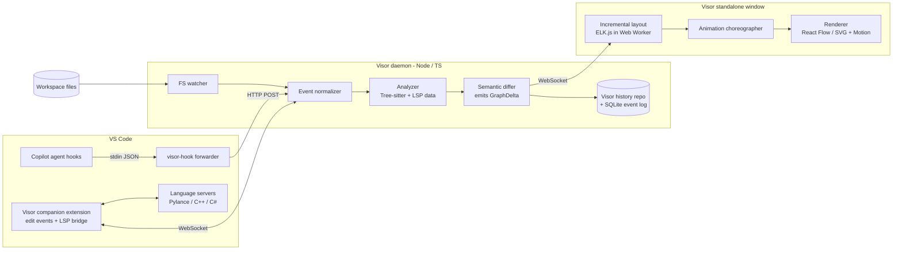

# Visor — Feasibility Report

**Visor** is a live visualizer that shows developers, in real time, the changes their coding agent is making.
Date: 2026-11-06

---

## Confirmed decisions

These decisions answer the open questions from the first version of this report. Nothing has been built yet; this document only records the plan.

| # | Topic | Decision | What it means for the design |
|---|---|---|---|
| D1 | Name | The application is called **Visor** | Components are named `visor-*` (e.g. `visor-hook`, the Visor companion extension) |
| D2 | Target | **VS Code**, with GitHub Copilot agent mode as the first agent | Events come from VS Code agent hooks plus a small Visor companion extension (section 2.0). Claude Code, Cursor, and others come later. |
| D3 | Languages | **Python first, then C++, then C#** | Tree-sitter grammars `tree-sitter-python`, `tree-sitter-cpp`, `tree-sitter-c-sharp`. Semantic data comes from the language servers already in VS Code (Pylance, the C/C++ extension or clangd, C# Dev Kit). |
| D4 | Window | **Standalone desktop window**, separate from VS Code | Visor ships as its own desktop app. The VS Code extension only bridges data; it doesn't host the UI. |
| D5 | Data flow and drill-down | Data flow is **in scope**. Visor shows **class-level changes first**; clicking a class opens its **code-level changes** | Edges carry calls, types, and composition (section 5). Each class has an animated code view. |
| D6 | Changed classes | A class that is **changed but not new glows with a pulsating animation** | New classes slide in; changed classes pulse (section 4). |
| D7 | History | Session history lives in **its own dedicated repository**, separate from the user's project repo | The project repo gets no extra folders, branches, commits, or `.gitignore` entries (section 6). |

---

## 1. Summary

**Verdict: Feasible.** Each part of the vision maps to proven technology. Connecting the coding agent to the app over an API is the lowest-risk piece. Most of the engineering effort goes into two things:

1. Turning raw text edits into a **stable semantic model** (classes, methods, relationships) that updates as the agent works.
2. **Animating graph changes** so the layout stays readable, even when the agent makes many edits in a short burst.

| Area | Feasibility | Risk | Notes |
|---|---|---|---|
| Hook → local API link | High | Low | VS Code: Copilot agent hooks plus the Visor companion extension (D2). Claude Code and Cursor also expose hooks for later support. |
| Live class / dependency diagram | High | Medium | Tree-sitter for parsing; LSP for richer relationships |
| Hover → method definition | High | Low | From the AST (signature, docstring, body) or LSP hover |
| Animated structural changes (make room, slide in) | High | Medium–High | Needs incremental layout plus a choreography layer. This is the core differentiator. |
| Animated line/paragraph insertion | High | Low–Medium | Text diff plus a custom code view with layout animations |
| Data flow (required, D5) | Medium | High | Calls, parameter/return types, composition, and inheritance from the language servers. Precision varies: untyped Python is approximate, and C++ needs build configuration. |
| Session history (before/after, replay) | High | Low | Snapshots in a dedicated Visor history repo (D7) plus an append-only event log |
| Steering (approve/deny/redirect the agent) | Medium–High | Medium | Pre-tool hooks can block a call and return a reason (Claude Code). Support differs by harness. |
| Bug-fix loop from the diagram | Medium | Medium | Send prompts back to the agent. Integration differs by harness. |

---

## 2. Is the API linking possible?

**Yes.** Section 2.0 describes the chosen setup for VS Code. Sections 2.1–2.3 describe the general channels, which also apply when other agents are added later.

### 2.0 Chosen setup for VS Code (D2)

Visor gets data from two sources inside VS Code:

1. **Copilot agent hooks** (preview) → `visor-hook` forwarder → Visor daemon. These provide *intent*: the user's prompt, which tool is about to run on which file, and when the session starts and stops.
2. **Visor companion extension**: a small VS Code extension with no UI of its own.
   - Captures every edit through `workspace.onDidChangeTextDocument`, `onDidCreateFiles`, `onDidDeleteFiles`, `onDidRenameFiles`, and a `FileSystemWatcher`. This includes edits the agent makes to open files before they're saved.
   - Answers Visor's semantic queries with VS Code's built-in commands: `vscode.executeDocumentSymbolProvider`, `vscode.prepareCallHierarchy` / `vscode.provideIncomingCalls` / `vscode.provideOutgoingCalls`, `vscode.prepareTypeHierarchy`, `vscode.executeHoverProvider`, `vscode.executeDefinitionProvider`. Visor reuses the language servers the developer already has (D3) instead of running its own.
   - Talks to the daemon over the same authenticated localhost WebSocket.

Copilot agent mode lets the user **Keep** or **Undo** the agent's edits. Visor must treat an Undo as a real change and animate the reversal.

### 2.1 Harness hooks (primary: captures *intent* and *what changed*)

At points in the agent's lifecycle, a hook runs a command and passes it a JSON payload on stdin. A small forwarder script sends that payload to the local daemon.

| Harness | Mechanism | Useful events |
|---|---|---|
| Claude Code | `hooks` in `.claude/settings.json` | `SessionStart`, `UserPromptSubmit`, `PreToolUse`, `PostToolUse`, `Stop`, `SubagentStop`, `SessionEnd` |
| GitHub Copilot (VS Code agent mode / Copilot CLI) | Agent hooks (preview) | Session start, prompt submit, pre/post tool use, stop |
| Cursor | `.cursor/hooks.json` | `beforeSubmitPrompt`, `afterFileEdit`, `beforeShellExecution`, `stop` |
| Others (Codex CLI, Aider, …) | Few or no hooks | Use 2.2 / 2.3 instead |

> Hook schemas change quickly. Check each harness's current docs before writing its adapter.

Example configuration (Claude Code, shown as a reference for the hook format):

```jsonc
// .claude/settings.json
{
  "hooks": {
    "PreToolUse":       [{ "matcher": "Write|Edit|MultiEdit", "hooks": [{ "type": "command", "command": "visor-hook pre" }] }],
    "PostToolUse":      [{ "matcher": "Write|Edit|MultiEdit", "hooks": [{ "type": "command", "command": "visor-hook post" }] }],
    "UserPromptSubmit": [{ "hooks": [{ "type": "command", "command": "visor-hook prompt" }] }],
    "Stop":             [{ "hooks": [{ "type": "command", "command": "visor-hook stop" }] }]
  }
}
```

Payload the hook receives (`PostToolUse` for an `Edit`, abbreviated):

```json
{
  "session_id": "abc123",
  "hook_event_name": "PostToolUse",
  "cwd": "D:/Projects/app",
  "transcript_path": "…/session.jsonl",
  "tool_name": "Edit",
  "tool_input": { "file_path": "src/b.ts", "old_string": "…", "new_string": "…" }
}
```

Requirements for the `visor-hook` forwarder:
- POST the payload to `http://127.0.0.1:<port>/events` with a short timeout (~200 ms).
- **Always exit 0** when the visualizer isn't running. The forwarder must never slow down or break the agent.
- Attach the auth token, read from a local file.

Bonus capabilities:
- `PreToolUse` fires *before* a change lands, so the UI can outline the node and show "agent is about to edit `ClassB.save()`". This keeps developers in the loop.
- `transcript_path` gives access to the agent's reasoning text, which can be shown as captions for each change.

### 2.2 File system watcher (fallback and ground truth)

- Watch the workspace with `chokidar` or `@parcel/watcher`. Ignore `.git`, virtual environments, `__pycache__`, `build/`, `bin/`, `obj/`, and other build output.
- Works with **any** agent, and with edits made by a human.
- Doesn't capture intent, but serves as the check on reality: the hook reports what the agent *intended*, and the watcher confirms what *actually* changed on disk. The watcher also catches changes made through shell commands (`sed`, codegen, formatters).

### 2.3 MCP server / instructions (optional, adds intent)

- Expose MCP tools such as `report_plan(steps)` or `annotate(symbol, note)`. Instruct the agent to call them through `AGENTS.md` or `copilot-instructions.md`.
- This can add a "plan" view before edits happen, but only on a **best-effort** basis: agents don't reliably follow instructions. Use it as enrichment, never as the source of truth.

---

## 3. Proposed architecture



### Components

1. **Forwarder (`visor-hook`)**: a small script or binary that sends hook payloads to the daemon. One adapter per harness (Copilot first) converts each payload into a common event format.
2. **Visor companion extension** (VS Code): captures edit events and answers semantic queries using the installed language servers (section 2.0).
3. **Visor daemon**: accepts events over HTTP and WebSocket, pushes updates to the window, and owns sessions and analysis.
4. **Analyzer**
   - Tree-sitter (`web-tree-sitter`, WASM grammars for Python, C++, C#): fast and **error-tolerant**. This matters because a file is often temporarily broken while the agent is midway through editing it.
   - Extracts classes and interfaces, methods (signature, docstring, body range), fields, imports, inheritance, and calls.
   - LSP data from the companion extension (call hierarchy, type hierarchy, resolved types, hover text). Required for data flow (D5).
5. **Semantic differ**: compares the model before and after each edit and emits `GraphDelta`s with stable IDs.
6. **Session store**: an append-only event log plus snapshots in the dedicated Visor history repo (D7).
7. **Visor window**: a standalone desktop app (D4). It opens, or comes to the front, when a session starts.

### Draft contracts: normalized events and deltas

```ts
type AgentEvent =
  | { kind: "session.start"; sessionId: string; harness: string; cwd: string; ts: number }
  | { kind: "intent";        sessionId: string; text: string; ts: number }             // user prompt / agent plan
  | { kind: "edit.pending";  sessionId: string; file: string; tool: string; ts: number }
  | { kind: "edit.applied";  sessionId: string; file: string; ts: number }
  | { kind: "command";       sessionId: string; cmd: string; exitCode?: number; ts: number }
  | { kind: "session.end";   sessionId: string; ts: number };

type GraphDelta =
  | { op: "node.add"; node: SymbolNode; insertedBetween?: [string, string] }
  | { op: "node.remove"; id: string }
  | { op: "node.rename"; from: string; to: string }
  | { op: "member.add" | "member.remove" | "member.change"; classId: string; member: MemberInfo }
  | { op: "edge.add" | "edge.remove"; from: string; to: string; kind: "calls" | "inherits" | "composes" | "imports" }
  | { op: "code.hunks"; file: string; symbolId?: string; hunks: Hunk[] };
```

---

## 4. How the animations work

The key idea: **animations aren't hard-coded for each scenario. They come from diffing the old and new layouts and choreographing the transition between them.**

Pipeline for each batch of deltas:

1. Apply the deltas to the graph model.
2. Re-run the layout **seeded with the previous positions** (ELK layered, with its interactive layering and crossing-minimization strategies) so that unchanged nodes move as little as possible. Research on dynamic graph drawing calls this preserving the user's "mental map".
3. For each node, compute the motion from its old position to its new one (FLIP technique).
4. Run the choreographer, which sequences the transition in phases:

| Phase | What happens |
|---|---|
| 1. Anticipate | The target node gets an "about to edit" outline (triggered by `edit.pending`) |
| 2. Make room | Existing nodes tween to their new positions |
| 3. Enter | The new node slides or fades in from its anchor |
| 4. Connect | Edges draw in (stroke-dash animation) |
| 5. Settle | New classes settle with a brief highlight. Changed classes keep a **pulsating glow** (D6). |

### Visual states (D5, D6)

| Change | Class-level view (default) | Code-level view (after clicking the class) |
|---|---|---|
| New class | Neighbors make room, the class slides in, its edges draw in | The whole class body appears as added |
| Changed class (not new) | **Pulsating glow** | A gap opens and new lines slide in; removed lines strike through and collapse; changed lines are highlighted |
| Removed class *(proposal)* | Fades and shrinks out; neighbors close the gap | The body is shown as removed |
| Relationship added or removed | The edge draws in or fades out | — |
| Data on an edge changes (e.g. a parameter type) | The edge label updates with a brief highlight | — |

### Your scenarios

**Class C added alongside A → B**
The layout makes space: A and B shift or compact. C slides in from the edge nearest its final position, and its new edge draws in.

**Class C inserted between A → B** (in one batch, edge `A→B` is removed and `A→C` and `C→B` are added)
- The differ tags the change as `insertedBetween: [A, B]`.
- A and B ease apart. The `A→B` edge stretches and splits at its midpoint, C scales in at the split point, and the two new edges settle.

**Class B changed, not new (D6)**
B glows with a pulsating animation. Its position stays the same unless its relationships change.

**Lines inserted into a method** (code-level view, D5)
- A text diff (Myers algorithm, e.g. the `diff` / `jsdiff` package) produces hunks.
- The code view opens a gap (height animates from 0 to n lines), then the new lines slide in and are highlighted. Deleted lines fade out with a strikethrough and collapse.
- Use a custom virtualized code view with layout animations (Framer Motion or GSAP). Monaco is well suited to reading code but awkward to animate line by line, so keep it for the static detail view.

### Bursts of edits (the real challenge)

An agent can write a dozen files in a few seconds. Without controls, the animations either fall behind what's actually happening or turn into noise.

- **Batch window** (e.g. 150–300 ms): merges deltas for the same file or class.
- **Animation queue with a latency budget**: if the queue falls more than N seconds behind, skip the intermediate states and animate straight to the latest one.
- **Playback controls**: live, pause, 0.5x–4x speed, and scrubbing.
- **Focus mode**: auto-pans to the area being edited, with a "follow agent" toggle.

---

## 5. Diagram content and scale

- **Touched set by default.** Showing the whole repo doesn't scale and isn't what developers need. Show the changed symbols plus their direct (1-hop) neighbors, and expand the view as the session progresses.
- **Semantic zoom**: module/package → class → method → code.
- **Two levels (D5).** The default view is class-level and shows which classes are new, changed, or removed. Clicking a class opens its code-level view: that class's code changes for the session, animated hunk by hunk. A back control returns to the class view at the same camera position.
- **Data flow (D5, in scope).** Edges between classes show both the relationship and what flows along it:
  - **Calls**: which method calls which (LSP call hierarchy).
  - **Data passed**: parameter and return types on each call edge.
  - **Composition**: fields that hold instances of other classes.
  - **Inheritance**: from the LSP type hierarchy.
  - Changed edges animate too: they draw in, fade out, or highlight when the types on them change.
  - Precision per language: Python data flow is only as precise as its type hints and Pylance's inference. C++ and C# are statically typed, so types are reliable once the language server is configured (section 10).
  - Tracking an individual value through variables and branches stays a later research item.
- **Hover**: signature, docstring, and a body preview from the AST, which is instant. LSP hover can add resolved types.
- **Free functions**: module-level functions (common in Python) and free functions (C++) appear inside a module or file node. The same engine applies.

---

## 6. Session history (before/after)

- **Where it lives (D7):** in a **dedicated Visor history repository**, separate from the user's project repo, e.g. `git --git-dir=<visor-history-root>/<project-id>.git --work-tree=<project>`. The project repo gets no extra folders, branches, commits, or `.gitignore` entries.
- **On `session.start`:** commit a snapshot of the workspace to the history repo.
- **During the session:** record each `edit.applied` as a row in the SQLite event log (stored next to the history repo), plus a commit in the history repo.
- **On `session.end`:** commit a final snapshot and tag it with the session ID.

This enables before/after diagram diffs, timeline scrubbing, animated replay, a per-step "why" linked to the prompt or agent message, and (later) rollback to any step.

---

## 7. Steering and bug fixes (future work, but feasible)

- **Steering:** Claude Code `PreToolUse` hooks can **deny** a tool call and return a reason that the agent sees. Other harnesses have, or are adding, similar capabilities. The visualizer could offer rules like "pause before edits to X", "approve/deny this change", or "don't touch this class", enforced by a hook that checks with the daemon. Blocking hooks add latency, so make this opt-in.
- **Context injection:** `UserPromptSubmit` and `SessionStart` hooks can add context to the agent, e.g. constraints the user pinned in the visualizer.
- **Bug-fix loop:** the user selects a node or hunk and clicks "Ask agent to fix". In VS Code (D2), the companion extension can open Copilot Chat with a prepared prompt. Other agents can be reached through their CLIs (e.g. `claude -p`, Copilot CLI).

---

## 8. Recommended tech stack

| Layer | Recommendation | Why |
|---|---|---|
| Daemon | Node.js + TypeScript (Fastify + `ws`) | Same language as the UI and the VS Code extension; good Tree-sitter and file-watcher libraries |
| Parsing | `web-tree-sitter` + Python, C++, and C# grammars (D3) | Multi-language, incremental, error-tolerant |
| Semantic data | Visor companion VS Code extension (D2) | Reuses Pylance, the C/C++ extension (or clangd), and C# Dev Kit for calls, types, and hover text |
| Storage | SQLite (`better-sqlite3`) + dedicated Visor history git repo (D7) | Simple, local, queryable |
| Layout | ELK.js in a Web Worker | Layered layouts, constraints, ports; supports seeding with previous positions |
| Rendering | React Flow (nodes as React components), or custom SVG/Canvas | React Flow speeds up the MVP; switch to a custom canvas (e.g. PixiJS) for very large graphs |
| Animation | Framer Motion / GSAP | Layout (FLIP) animations, timelines, sequencing |
| Shell | Standalone desktop app (D4): Electron recommended, Tauri as a lighter alternative | Electron can run the Node daemon in its main process, so Visor ships as one app |

**Chosen split:** the VS Code extension supplies edit events and language-server data; the standalone Visor app owns analysis, history, and the UI. Visor gets its own window (D4) while still reusing VS Code's language servers, and other agents can be added later.

---

## 9. Security considerations

A local server that receives code-change events, and can later steer an agent, is a sensitive attack surface.

- Bind to `127.0.0.1` only, never `0.0.0.0`.
- Generate a random token per install, store it in the user profile with restricted file permissions, and require it on every HTTP and WebSocket request.
- Validate `Origin` and `Host` headers to block DNS rebinding and requests triggered by websites the user visits.
- Validate payloads and limit their size. Treat file paths as untrusted: resolve them and confine them to the workspace root.
- Render code and agent messages as text, never as HTML, to avoid XSS.
- Observation hooks fail open (exit 0). Steering hooks must fail **safe** and be an explicit opt-in.
- Don't persist secrets in snapshots: respect `.gitignore` and add a deny-list (`.env`, key files).

---

## 10. Risks and mitigations

| Risk | Impact | Mitigation |
|---|---|---|
| Layout jumps destroy the user's mental map | High | Position-seeded layout, constrained movement, pinned nodes, small-step tweens |
| Animations fall behind fast agents | High | Batching, latency budget, skip to latest state, playback controls |
| Files can't be parsed mid-edit | Medium | Tree-sitter error tolerance, keep the last good model per file, debounce |
| Detecting renames and moves (symbol identity) | Medium | Stable IDs from qualified names, plus similarity heuristics on body and signature |
| Hook APIs differ between harnesses and change over time | Medium | One adapter per harness feeding a single normalized event schema; FS watcher fallback |
| Large repos | Medium | Touched-set view, lazy parsing, Web Workers |
| Data flow precision (required, D5) | High | Use language-server data rather than custom analysis; mark inferred or unknown types visually |
| Python: dynamic typing | Medium | Use Pylance inference; show untyped edges as "approximate" |
| C++: classes split across header and source files; macros and templates | Medium–High | Merge declarations and definitions into one class node by qualified name. Rely on the C/C++ language server, which needs `compile_commands.json` or equivalent build configuration for accurate results. |
| C#: partial classes across files | Medium | Merge partial declarations by fully qualified name |
| Language servers missing or still indexing | Medium | Fall back to a Tree-sitter-only model and show an "indexing" state |
| Copilot Keep/Undo reverts edits | Low–Medium | Treat reverts as normal changes and animate them |
| Copilot agent hooks are in preview and may change | Medium | Keep the hook adapter thin; the companion extension's edit events still work without hooks |
| Too much information for the developer | Medium | Focus mode, quiet mode, a summary per step |

---

## 11. Phased plan

1. **Spike: the link.** Copilot agent hooks and the companion extension → daemon → WebSocket → a standalone window that prints events live.
2. **MVP: Python, class level.** Tree-sitter plus Pylance data, class diagram, new classes slide in, changed classes pulse, hover signatures.
3. **Code level and data flow.** Click a class to open its animated code view; call, type, and composition edges with data labels.
4. **Choreography.** "Make room", "insert between", and gap-and-slide for code hunks; batching and playback controls.
5. **History.** Dedicated Visor history repo, timeline scrubber, before/after diff view, replay.
6. **C++ support.** Header/source merging and C/C++ language server integration.
7. **C# support.** Partial class merging and C# Dev Kit integration.
8. **Steering and bug-fix loop.** Approve/deny through pre-tool hooks; send fix prompts to Copilot Chat.
9. **Other agents.** Claude Code, Cursor, and others through additional hook adapters.

---

## 12. Prior art worth studying

- **Gource**: animated version-control history; a good reference for organic motion.
- **Sourcetrail** (open-sourced, discontinued): UX for exploring a code graph.
- **CodeSee** (now part of GitKraken): code maps and change review.
- **Agent checkpoints** in Claude Code, Cursor, and Copilot: snapshot and rollback models.
- **Research:** dynamic graph drawing and mental-map preservation (incremental layout algorithms).

As far as we know, none of these combines real-time agent hooks, a semantic diagram, and choreographed animation. That combination is the novel part.

---

## 13. Open questions

The first round of questions is answered in **Confirmed decisions** (D1–D7). Remaining questions:

1. How long does a changed class keep pulsing: until the user clicks it, until the session ends, or for a fixed time?
2. How should removed classes look? (Section 4 has a proposal.)
3. Desktop shell: Electron (recommended) or Tauri?
4. Where does the history repository live by default, and is it one repository per project or one for all projects?
5. Does the code-level view show the whole class with changes inline, or only the changed hunks?
6. Should Visor also show edits the developer makes by hand during an agent session, or only the agent's edits?
